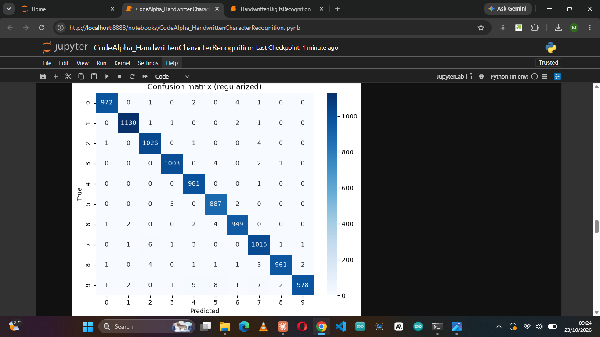
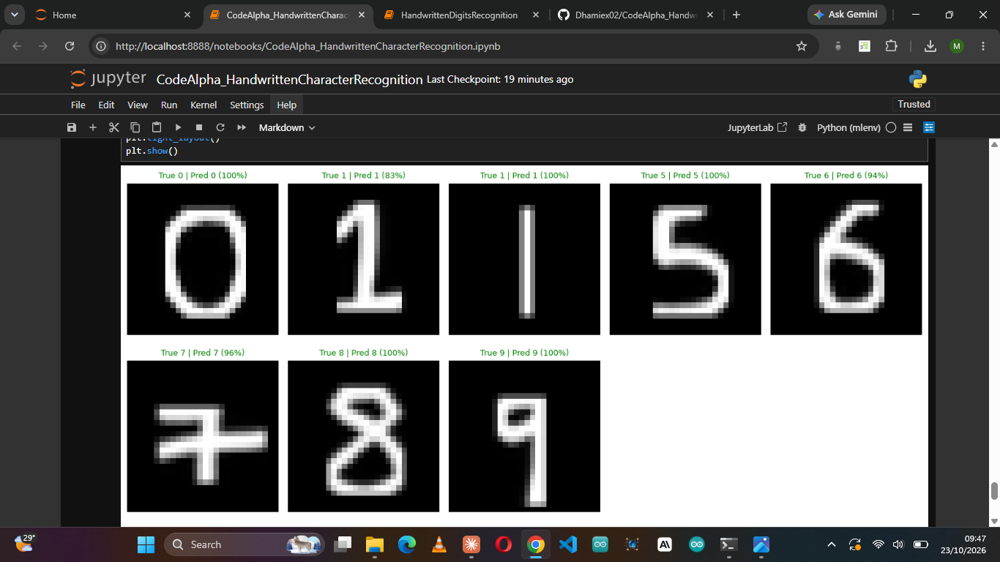

# Handwritten Character Recognition (MNIST CNN)

**CodeAlpha Machine Learning Internship, Task 3**

A convolutional neural network that recognises handwritten digits, built with Keras/TensorFlow. The project goes beyond MNIST test accuracy: it also includes a preprocessing pipeline that lets the model read **photos of real handwriting** taken on a phone.

## Results

| Metric | Value |
|---|---|
| Dataset | MNIST (60,000 train / 10,000 test) |
| Selected model | `regularized` CNN (augmentation + Dropout) |
| **Test accuracy** | **99.02%** (9,902 / 10,000) |
| Misclassified | 98 images |

**Most confused pair:** 2 ↔ 7 (10 errors).
**Weakest digit:** 9, with 31 of the 98 errors, most often read as 4, 5 or 7.



### Own handwriting

Beyond the test set, I photographed my own digits with a phone and ran them through the model.

<!-- Fill in after running Section 8 of the notebook -->
- Accuracy on my own digits: **10/10**
- Notable successes and failures: **Got 100% success rate on my own digits**



## Models compared

Three CNNs were trained and compared on a validation split (10% of the training set), with early stopping. The test set was used only once, on the selected model.

| Model | Architecture |
|---|---|
| `baseline` | 1 Conv block, Dense(64) |
| `deeper` | 2 Conv blocks, Dense(64) |
| `regularized` | 2 Conv blocks, random rotation and translation augmentation, Dropout(0.4 and 0.3) |

## Pipeline

1. **Preprocess:** normalize pixels to [0, 1] and reshape to `(N, 28, 28, 1)`.
2. **Train:** Adam optimizer, sparse categorical cross-entropy, batch size 128, early stopping on validation loss.
3. **Evaluate:** accuracy, confusion matrix, per-class precision/recall/F1, and a grid of misclassified examples.
4. **Predict on real photos:** see below.

### Reading photos of handwriting

MNIST digits are thick, centred, white strokes on a black background. A phone photo of pen on paper is none of these, so `preprocess_image` converts it step by step:

1. Estimate the paper's brightness and subtract it, which removes shadows and uneven lighting.
2. Keep only the strong ink pixels and crop to the largest blob (the digit).
3. Thicken the thin pen stroke to match MNIST stroke width.
4. Resize the longest side to 20 px and centre it by centre of mass in a 28×28 frame.

A naive threshold failed on shadowed photos (about 93% of the image counted as ink), which is why this step matters.

## Repository structure

```
CodeAlpha_HandwrittenCharacterRecognition/
├── CodeAlpha_HandwrittenCharacterRecognition.ipynb   # full notebook
├── mnist_cnn.keras                                   # trained model
├── samples/                                          # my own digit photos (e.g. 8_crossed.jpeg)
├── images/                                           # screenshots used in this README
├── requirements.txt
└── README.md
```

## How to run

```bash
git clone https://github.com/<your-username>/CodeAlpha_HandwrittenCharacterRecognition.git
cd CodeAlpha_HandwrittenCharacterRecognition
pip install -r requirements.txt
jupyter notebook CodeAlpha_HandwrittenCharacterRecognition.ipynb
```

Run the cells top to bottom. To test your own digits, put photos in `samples/` and name each file with the true digit first (for example `3_a.png`). Section 8 predicts them all and reports accuracy.

## Requirements

`requirements.txt`:

```
tensorflow
numpy
pandas
matplotlib
seaborn
scikit-learn
scipy
pillow
jupyter
```

## Limitations and future work

- Handles **single digits** only. A photo with several digits must be cropped first.
- Trained on digits 0-9 only. Next step: **EMNIST** for letters.
- Extend to words and sentences with a **CRNN** (sequence modelling).
- Weakest on digits with small closed loops or unusual shapes (for example, my crossed 7 and looped 9).

## Author

**Dhamiex'**
[LinkedIn](https://www.linkedin.com/in/fayemi-oluwadamilare-a7a78a2a7) · [GitHub](https://github.com/Dhamiex02)

Built as part of the CodeAlpha Machine Learning Internship.
